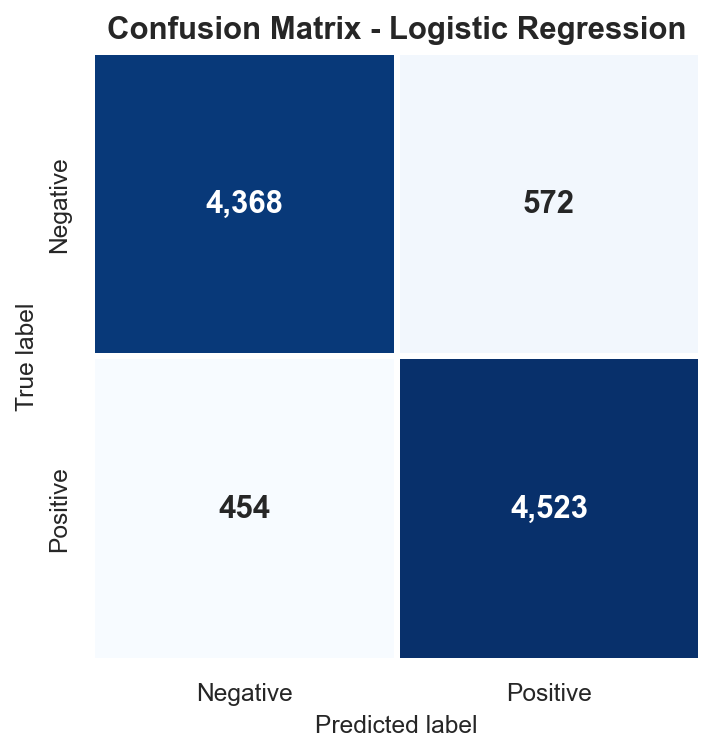

# Sentiment Analysis System

## A Classical NLP and Machine-Learning Project for Binary Movie-Review Classification

**Project report submitted in partial fulfilment of the requirements of the
B.Tech. Machine Learning / NLP project**

| Field | Detail |
|---|---|
| Project title | Sentiment Analysis System using TF-IDF and Classical Machine Learning |
| Student | ______________________________ |
| Roll number | ______________________________ |
| Department | Computer Science and Engineering |
| Guide | ______________________________ |
| Academic year | 2026–27 |
| Dataset | IMDb Large Movie Review Dataset (50,000 reviews) |
| Implementation | Python, scikit-learn, NLTK, Streamlit |

---

## 1. Abstract

Sentiment analysis is the automatic identification of the opinion expressed in
text. This project builds a complete binary sentiment-classification system for
movie reviews using classical natural-language-processing and machine-learning
techniques. The system is trained on the real IMDb Large Movie Review Dataset,
which contains 50,000 labelled reviews (25,000 positive and 25,000 negative).

The text is cleaned with a shared preprocessing pipeline: contractions are
expanded, HTML and URLs are removed, the text is tokenised with NLTK, stop-words
are removed while negations are preserved, and the remaining words are reduced
to stems with the Porter stemmer. The cleaned text is converted into 50,000
TF-IDF features using unigrams and bigrams. Two classifiers are trained on the
same feature matrix: Multinomial Naive Bayes and Logistic Regression. TF-IDF is
fitted on the training split only, which prevents test-set leakage.

On a stratified 20% held-out test set of 9,917 reviews, Logistic Regression
achieved **89.65% accuracy** and a **weighted F1-score of 0.8965**, while Naive
Bayes achieved **87.79% accuracy** and a **weighted F1-score of 0.8779**. Logistic
Regression was selected as the final model and saved with Joblib together with
the vectorizer and a metadata file. A four-page Streamlit application loads the
saved artifacts and provides live prediction, model-performance dashboards,
sample reviews and an honest confidence warning. The system deliberately does
not invent a Neutral class, because the training data contains no neutral labels.

**Keywords:** sentiment analysis, natural language processing, TF-IDF, Naive
Bayes, logistic regression, scikit-learn, NLTK, Streamlit, IMDb.

---

## 2. Introduction

### 2.1 Problem statement

People express opinions constantly in reviews, comments, social-media posts and
feedback forms. Reading and labelling this text manually is slow and inconsistent.
A sentiment classifier learns statistical patterns from labelled examples and can
then assign a positive or negative label to new text automatically.

The problem addressed here is **supervised binary text classification**:

> Given a raw movie review, predict whether its overall sentiment is positive or
> negative, and report a probability that expresses how confident the model is.

The project is intentionally limited to classical methods. It does not use BERT,
transformers, large language models or paid APIs. This keeps the pipeline
understandable, reproducible on a normal laptop and suitable for explaining every
step in a viva.

### 2.2 Motivation

Movie reviews are a good test bed because:

- large, public, human-labelled datasets are available;
- the two classes are balanced, so accuracy is interpretable;
- reviews contain realistic noise such as HTML fragments, punctuation, negation
  and sarcasm;
- the domain is easy to demonstrate to an audience.

The project also demonstrates an important engineering principle: the exact same
preprocessing and feature extraction must be used during training and prediction.
A model that performs well in a notebook but receives differently cleaned text in
production is a common and avoidable failure.

### 2.3 Scope

In scope:

- binary positive/negative classification;
- IMDb 50K dataset;
- TF-IDF features with unigrams and bigrams;
- Multinomial Naive Bayes and Logistic Regression;
- a reproducible train/test split and full evaluation;
- saved model artifacts;
- a Streamlit user interface;
- command-line prediction;
- documentation, tests and viva preparation.

Out of scope:

- a neutral class (not supported by the dataset);
- sarcasm detection as a separate task;
- multilingual text;
- transformer or LLM models;
- cloud deployment, authentication or a production database.

---

## 3. Objectives

1. Acquire and validate the IMDb 50K dataset.
2. Build a reusable text-cleaning pipeline that preserves sentiment-bearing
   negations and contrast words.
3. Convert text into TF-IDF features without leaking test data into the
   vectorizer.
4. Train and compare Multinomial Naive Bayes and Logistic Regression.
5. Evaluate both models with accuracy, precision, recall, F1 and confusion
   matrices.
6. Select the better model using a documented, reproducible rule.
7. Persist the model, vectorizer and metadata with Joblib.
8. Build a polished Streamlit application that loads the saved model and never
   retrains during a user request.
9. Provide a command-line interface for quick verification.
10. Document the methodology, results, limitations, viva questions and demo
    workflow.

---

## 4. Background and related concepts

### 4.1 Classical versus deep-learning approaches

Modern sentiment systems often use transformers such as BERT. They capture
context and word order well but require large models, more memory and longer
training. Classical approaches represent text as sparse lexical features and
train shallow classifiers. They are fast, interpretable and strong baselines on
datasets such as IMDb. This project chooses the classical approach because the
goal is to understand and explain the full pipeline, not to maximise a benchmark
at any cost.

### 4.2 Bag-of-words and TF-IDF

A bag-of-words model ignores word order and represents a document by its word
frequencies. Term Frequency–Inverse Document Frequency (TF-IDF) improves on raw
counts by down-weighting terms that occur in almost every document and
up-weighting terms that are frequent in a document but rare across the corpus.

With sublinear term frequency:

```text
tf(t, d) = 1 + log(count(t, d))
idf(t)   = log((1 + n) / (1 + df(t))) + 1
weight   = tf(t, d) × idf(t)
```

The resulting vector is L2-normalised by scikit-learn. Bigrams extend the
representation with adjacent word pairs, so phrases such as `not good` and
`waste time` can receive their own weights.

### 4.3 Multinomial Naive Bayes

Naive Bayes applies Bayes' theorem and assumes that features are conditionally
independent given the class. For text classification, the model estimates the
probability of each word given each class and combines them:

```text
P(class | document) ∝ P(class) × Π P(token | class)
```

Laplace smoothing (`alpha=1.0`) prevents zero probabilities for words that did
not appear in a class during training. The independence assumption is unrealistic
for language, but the model is fast and surprisingly competitive.

### 4.4 Logistic Regression

Logistic Regression learns a weight for every feature and computes:

```text
z = w · x + b
P(positive | x) = 1 / (1 + exp(-z))
```

The weights are chosen by minimising a log-loss objective with L2
regularisation. Unlike Naive Bayes, the weights are jointly optimised, which
often produces a better decision boundary when many words overlap between
classes.

### 4.5 Evaluation metrics

For binary classification:

```text
Accuracy  = (TP + TN) / (TP + TN + FP + FN)
Precision = TP / (TP + FP)
Recall    = TP / (TP + FN)
F1        = 2 × Precision × Recall / (Precision + Recall)
```

Weighted averages weight each class by its support. Macro averages give both
classes equal weight. A confusion matrix shows the four counts directly and makes
the two error types visible.

---

## 5. Requirements

### 5.1 Functional requirements

| ID | Requirement |
|---|---|
| F1 | Load an IMDb CSV with `review` and `sentiment` columns. |
| F2 | Validate labels, remove missing/empty rows and exact duplicates. |
| F3 | Preprocess text consistently for training and prediction. |
| F4 | Fit TF-IDF on the training split only. |
| F5 | Train Multinomial Naive Bayes and Logistic Regression. |
| F6 | Calculate accuracy, precision, recall, F1 and confusion matrices. |
| F7 | Select the best model by weighted F1 with accuracy as tie-breaker. |
| F8 | Save model, vectorizer and metadata with Joblib. |
| F9 | Load saved artifacts in the app without retraining. |
| F10 | Provide live binary prediction with per-class probabilities. |
| F11 | Display a low-confidence warning below 60%. |
| F12 | Show evaluation charts and per-class reports in the UI. |
| F13 | Provide sample reviews that can be analysed in one click. |
| F14 | Provide a command-line prediction interface. |
| F15 | Report clear errors for missing artifacts **and** empty input. |

### 5.2 Non-functional requirements

| ID | Requirement |
|---|---|
| N1 | Reproducibility: fixed random state and documented versions. |
| N2 | Correctness: no test data used to fit the vectorizer or classifier. |
| N3 | Usability: clear labels, readable typography and responsive layout. |
| N4 | Performance: prediction should return in under a second on a laptop. |
| N5 | Maintainability: small modules with docstrings and type hints. |
| N6 | Portability: macOS, Linux or Windows with Python 3.12+. |
| N7 | Privacy: reviews are processed in memory and not sent to any API. |
| N8 | Honesty: no fabricated metrics and no unsupported neutral class. |

### 5.3 Hardware and software requirements

**Minimum hardware**

- Dual-core CPU
- 8 GB RAM
- 2 GB free disk space
- No GPU required

**Software**

| Component | Version used |
|---|---|
| Operating system | macOS (project also runs on Linux/Windows) |
| Python | 3.14.4 (3.12+ recommended) |
| scikit-learn | 1.8.0 |
| NLTK | 3.10.4 |
| pandas | 3.0.2 |
| NumPy | 2.4.4 |
| Matplotlib | 3.10.9 |
| Seaborn | 0.13.2 |
| Joblib | 1.5.3 |
| Streamlit | 1.60.0 |
| Starlette | 0.49.3 (pinned for Streamlit compatibility) |

---

## 6. Dataset description

### 6.1 Source and citation

The IMDb Large Movie Review Dataset was introduced by Maas et al. in 2011. It is
distributed by Stanford at:

<https://ai.stanford.edu/~amaas/data/sentiment/>

Citation:

> Andrew L. Maas, Raymond E. Daly, Peter T. Pham, Dan Huang, Andrew Y. Ng, and
> Christopher Potts. 2011. *Learning Word Vectors for Sentiment Analysis.*
> Proceedings of ACL 2011.

### 6.2 Structure

The archive contains labelled train and test folders, plus unlabelled reviews.
This project uses only the labelled positive and negative reviews and combines
them into one shuffled CSV before making its own split. This gives a clean,
controlled 80/20 experiment rather than relying on the archive's original split.

`data/dataset.csv` has two columns:

| Column | Meaning |
|---|---|
| `review` | Raw review text |
| `sentiment` | `positive` or `negative` |

### 6.3 Cleaning results

| Quantity | Value |
|---|---:|
| Rows loaded | 50,000 |
| Missing reviews | 0 |
| Missing labels | 0 |
| Invalid labels | 0 |
| Empty reviews | 0 |
| Duplicate texts removed | 418 |
| Final rows | 49,582 |
| Positive rows | 24,884 (50.19%) |
| Negative rows | 24,698 (49.81%) |
| Average length | 231.35 words |
| Median length | 173 words |

The class balance is excellent, so a stratified split is straightforward and
accuracy is not misleading.

### 6.4 Data quality observations

- Reviews contain HTML line breaks and entities (`<br />`, `&amp;`).
- Some reviews include URLs or e-mail addresses.
- Punctuation and numbers are common and are not useful lexical sentiment cues.
- Negations such as “not”, “never” and “wasn't” are frequent and must not be
  discarded as ordinary stop-words.
- A small number of exact duplicate reviews exist across the source folders and
  are removed before splitting.

---

## 7. Methodology

### 7.1 System architecture

```text
┌────────────────────┐
│ IMDb archive / CSV │
└─────────┬──────────┘
          │
          ▼
┌────────────────────┐
│ Validate + dedupe  │  src/data_utils.py
└─────────┬──────────┘
          │
          ▼
┌────────────────────┐
│ Stratified 80/20   │  random_state = 42
└─────────┬──────────┘
          │
          ▼
┌────────────────────┐
│ Shared preprocessing│  src/preprocessing.py
│ clean → tokens → stems
└─────────┬──────────┘
          │
          ▼
┌────────────────────┐
│ TF-IDF fit on train│  50,000 uni+bigram features
│ transform test     │  no leakage
└─────────┬──────────┘
          │
          ├───────────────┐
          ▼               ▼
┌─────────────────┐  ┌──────────────────┐
│ Multinomial NB  │  │ LogisticRegression│
└────────┬────────┘  └────────┬─────────┘
         └──────────┬─────────┘
                    ▼
         ┌────────────────────┐
         │ Metrics + charts   │
         │ weighted-F1 select │
         └─────────┬──────────┘
                   ▼
         ┌────────────────────┐
         │ Joblib artifacts   │
         │ + metadata JSON    │
         └─────────┬──────────┘
                   ▼
         ┌────────────────────┐
         │ Streamlit app      │
         │ CLI predictor      │
         └────────────────────┘
```

### 7.2 Data validation and duplicate removal

`src/data_utils.py` normalises the label column, accepts common synonyms
(`pos`/`neg`, `1`/`0`), drops missing or empty reviews, rejects unsupported
labels, and removes exact duplicate review texts. The cleaned data is then split.

### 7.3 Stratified train/test split

```python
X_train_raw, X_test_raw, y_train, y_test = train_test_split(
    X_raw,
    y,
    test_size=0.20,
    random_state=42,
    stratify=y,
)
```

| Split | Rows | Negative | Positive |
|---|---:|---:|---:|
| Train | 39,665 | 19,758 | 19,907 |
| Test | 9,917 | 4,940 | 4,977 |

### 7.4 Preprocessing pipeline

The same function is used in training and prediction:

1. Normalise typographic apostrophes.
2. Lowercase.
3. Expand common contractions (`won't` → `will not`, `wasn't` → `was not`).
4. Unescape HTML entities and strip tags.
5. Remove URLs and e-mail addresses.
6. Replace non-letter characters with spaces.
7. Collapse whitespace.
8. Tokenise with NLTK `word_tokenize`.
9. Remove English stop-words, minus a sentiment keep-list.
10. Porter-stem the remaining tokens.
11. Join tokens with spaces.

**Negations kept:** `not`, `no`, `nor`, `never`, `none`, `nothing`, `neither`,
`nowhere`, `cannot`, `without`.

**Contrast/intensifiers kept:** `but`, `however`, `yet`, `although`, `though`,
`very`, `too`, `really`, `extremely`.

Keeping `not` matters because `good` and `not good` have opposite meanings.
Keeping `but` matters because the clause after it often carries the reviewer's
final judgement.

### 7.5 TF-IDF feature extraction

```python
vectorizer = TfidfVectorizer(
    ngram_range=(1, 2),
    max_features=50_000,
    min_df=2,
    max_df=0.95,
    sublinear_tf=True,
    strip_accents="unicode",
    lowercase=False,
    token_pattern=r"(?u)\b\w+\b",
)
X_train = vectorizer.fit_transform(X_train_clean)  # train only
X_test = vectorizer.transform(X_test_clean)        # no fitting
```

Justification:

- **Unigrams + bigrams:** capture individual sentiment words and short phrases.
- **50,000 features:** a good trade-off between coverage and memory.
- **`min_df=2`:** drops one-off typos and names.
- **`max_df=0.95`:** drops tokens that appear in almost every review.
- **`sublinear_tf=True`:** prevents repeated words from dominating.
- **Fit on train only:** the test vocabulary and IDF weights remain unseen.

### 7.6 Models

**Multinomial Naive Bayes**

```python
MultinomialNB(alpha=1.0)
```

**Logistic Regression**

```python
LogisticRegression(
    C=1.0,
    solver="liblinear",
    max_iter=1000,
    random_state=42,
)
```

Both models receive the same `X_train`, `y_train`, `X_test` and `y_test`.

### 7.7 Evaluation and model selection

Metrics: accuracy, weighted precision, weighted recall, weighted F1, macro
precision/recall/F1, positive-class precision/recall/F1, confusion matrix and a
full per-class classification report.

Selection rule: **highest weighted F1 on the held-out test set**, with accuracy
as a tie-breaker. Weighted F1 is preferred because it accounts for both classes
and balances precision and recall.

### 7.8 Saving and loading

The selected classifier and vectorizer are saved with Joblib compression:

```text
models/sentiment_model.pkl
models/tfidf_vectorizer.pkl
models/model_metadata.json
```

`SentimentPredictor` loads these files, checks that the vectorizer vocabulary
size matches the classifier's expected feature count, applies the shared
preprocessing function, calls `transform`, and returns probabilities. It never
calls `fit` at prediction time.

### 7.9 User interface

The app uses `st.navigation` with four pages:

1. **Home** — project overview, real model snapshot and pipeline.
2. **Analyzer** — text input, prediction card, probability bars, preprocessing
   details and low-confidence warning.
3. **Model Performance** — metrics, comparison chart/table, confusion matrices,
   per-class reports, top features and methodology.
4. **Sample Reviews** — six clear examples plus three tricky cases, each with a
   one-click “Analyze” action.

The UI is deliberately honest: low-confidence predictions are flagged, the
binary limitation is explained, and no neutral result is fabricated.

---

## 8. Implementation

### 8.1 Project structure

```text
.
├── streamlit_app.py            # Local Streamlit application
├── server.py                   # Flask API for the Vercel deployment
├── vercel.json                 # Vercel function configuration
├── .python-version             # Vercel Python version
├── requirements.txt            # Slim runtime dependencies for Vercel
├── requirements-local.txt      # Streamlit, training and chart dependencies
├── README.md
├── evaluation_report.md
├── .streamlit/config.toml
├── public/                     # Static analyzer UI served by Vercel
│   ├── index.html
│   ├── styles.css
│   ├── app.js
│   └── reports/                # Evaluation charts for the static UI
├── nltk_data/                  # English stop-words and punkt_tab data
├── data/
│   ├── README.md
│   └── dataset.csv
├── docs/
│   ├── PROJECT_REPORT.md
│   ├── VIVA_QA.md
│   ├── DEMO_SCRIPT.md
│   └── SCREENSHOTS.md
├── models/
│   ├── sentiment_model.pkl
│   ├── tfidf_vectorizer.pkl
│   └── model_metadata.json
├── reports/
│   ├── class_distribution.png
│   ├── model_comparison.png
│   ├── confusion_matrix_naive_bayes.png
│   ├── confusion_matrix_logistic_regression.png
│   ├── top_features.png
│   ├── classification_report_naive_bayes.txt
│   ├── classification_report_logistic_regression.txt
│   ├── dataset_sample.txt
│   ├── preprocessing_examples.txt
│   └── training_run.log
├── scripts/
│   ├── download_dataset.py
│   └── setup_nltk.py
├── src/
│   ├── config.py
│   ├── data_utils.py
│   ├── preprocessing.py
│   ├── nltk_setup.py
│   ├── evaluation.py
│   ├── train.py
│   └── predict.py
└── tests/
    ├── test_preprocessing.py
    └── test_artifacts.py
```

### 8.2 Important implementation details

**Shared preprocessing.** `train.py` and `predict.py` import the same
`preprocess_text` function. There is no second “app version” of the cleaning
code.

**Leakage prevention.** The vectorizer is fitted with
`fit_transform(X_train_clean)` and only `transform(X_test_clean)` is used for the
test data. This is easy to state in a viva and easy to verify in the code.

**Artifact consistency check.** On load, the predictor compares the vectorizer's
learned vocabulary size with the classifier's `n_features_in_`. If the files are
from different runs, it raises a clear error instead of producing nonsense.

**Confidence.** The app reports the probability of the predicted class and labels
it High (≥75%), Moderate (60–75%) or Low (<60%). Below 60%, a warning explains
that the model is binary and is not predicting “neutral”.

**No retraining in the UI.** The predictor is cached with `st.cache_resource`, but
the cache only holds a loaded object. Training happens exclusively in
`src/train.py`.

### 8.3 Execution workflow

```bash
# 1. Environment
python3 -m venv .venv
source .venv/bin/activate
pip install -r requirements-local.txt

# 2. NLTK resources
python scripts/setup_nltk.py
chmod -R go-w ~/nltk_data

# 3. Dataset
python scripts/download_dataset.py

# 4. Train, evaluate and save
python src/train.py

# 5. Run the app
python -m streamlit run streamlit_app.py
```

### 8.4 Deployment architecture

The Streamlit application remains the local demonstration interface. Vercel
cannot host Streamlit because it requires a long-lived WebSocket server, while
Vercel Functions are request-scoped. The deployed version therefore uses a
separate but equivalent serving path:

- `server.py` exposes `GET /api/health`, `GET /api/metadata` and
  `POST /api/predict` using Flask.
- `public/` contains the static analyzer, performance dashboard and copied
  evaluation charts.
- The API loads the same saved Joblib classifier and vectorizer through
  `src.predict`, so predictions and preprocessing are identical to the
  Streamlit app.
- `nltk_data/` is bundled in the function so the serverless environment does
  not rely on a developer machine.
- `requirements.txt` contains only the runtime packages needed by the API;
  `requirements-local.txt` adds Streamlit, training and chart dependencies.

This keeps the deployed application honest: it serves the measured binary
classifier rather than retraining, calling an external API, or simulating a
neutral class.

### 8.5 Application workflow

1. The user opens the Home page and sees the model snapshot.
2. The user goes to **Sentiment Analyzer**.
3. The raw review is passed to `preprocess_text`.
4. The cleaned text is transformed by the saved TF-IDF vectorizer.
5. The saved Logistic Regression model returns class probabilities.
6. The UI shows the label, confidence, probability bars and optional cleaned
   tokens.
7. If confidence is below 60%, the low-confidence warning is displayed.
8. The user can compare the result with the real test-set metrics on the
   **Model Performance** page.

### 8.6 Interface walkthrough

The running application has four pages:

- **Home** introduces the problem, the dataset, the pipeline and the honest
  scope of the model.
- **Sentiment Analyzer** accepts a review, runs the shared preprocessing,
  TF-IDF transform and saved classifier, and shows the label, confidence and
  probability split. Predictions below 60% confidence display a warning.
- **Model Performance** reports the measured test metrics, comparison chart,
  confusion matrices, per-class reports, learned features and method summary.
- **Sample Reviews** provides one-click positive, negative and mixed examples,
  including a low-confidence case.

The optional `docs/SCREENSHOTS.md` guide explains how to capture your own
interface images if they are required for a submission.

### 8.7 Demonstration workflow

**Presentation workflow (5–7 minutes):**

1. State the problem and the binary scope.
2. Show the Home page and the real model snapshot.
3. Demonstrate a positive review and a negative review.
4. Demonstrate the mixed review and explain the low-confidence warning.
5. Show the comparison chart, confusion matrix and per-class report.
6. Explain one limitation (`not bad` or sarcasm) and one future improvement.
7. Close with the saved-artifact workflow: training is separate from serving.

---

## 9. Results and discussion

### 9.1 Headline results

| Model | Accuracy | Precision (weighted) | Recall (weighted) | F1 (weighted) |
|---|---:|---:|---:|---:|
| Multinomial Naive Bayes | 0.8779 | 0.8780 | 0.8779 | 0.8779 |
| **Logistic Regression** | **0.8965** | **0.8968** | **0.8965** | **0.8965** |

Logistic Regression was selected. It improved accuracy by **1.86 percentage
points** and reduced test errors from **1,211** to **1,026**.

### 9.2 Confusion matrices

**Logistic Regression**

|  | Predicted Negative | Predicted Positive |
|---|---:|---:|
| True Negative | 4,368 | 572 |
| True Positive | 454 | 4,523 |

**Naive Bayes**

|  | Predicted Negative | Predicted Positive |
|---|---:|---:|
| True Negative | 4,299 | 641 |
| True Positive | 570 | 4,407 |




### 9.3 Per-class results

**Logistic Regression**

| Class | Precision | Recall | F1 | Support |
|---|---:|---:|---:|---:|
| Negative | 0.9058 | 0.8842 | 0.8949 | 4,940 |
| Positive | 0.8877 | 0.9088 | 0.8981 | 4,977 |
| Macro avg | 0.8968 | 0.8965 | 0.8965 | 9,917 |
| Weighted avg | 0.8968 | 0.8965 | 0.8965 | 9,917 |

**Naive Bayes**

| Class | Precision | Recall | F1 | Support |
|---|---:|---:|---:|---:|
| Negative | 0.8829 | 0.8702 | 0.8765 | 4,940 |
| Positive | 0.8730 | 0.8855 | 0.8792 | 4,977 |
| Macro avg | 0.8780 | 0.8779 | 0.8779 | 9,917 |
| Weighted avg | 0.8780 | 0.8779 | 0.8779 | 9,917 |

### 9.4 Interpretation

- Both models are far above the 50.2% majority-class baseline.
- Logistic Regression is better on every headline metric, especially
  positive-class recall (0.9088 vs 0.8855).
- Naive Bayes trains almost instantly (0.02 s) and is an excellent baseline.
- The selected model's errors are reasonably balanced: 572 false positives and
  454 false negatives.
- The learned coefficients are intuitive: `great`, `excel`, `perfect`, `love`
  push positive; `worst`, `bad`, `wast`, `bore` push negative.

### 9.5 Training time

| Stage | Time |
|---|---:|
| Preprocess training text | 33.26 s |
| Preprocess test text | 8.23 s |
| TF-IDF fit/transform | 13.59 s |
| Train Naive Bayes | 0.02 s |
| Train Logistic Regression | 0.72 s |

Preprocessing dominates. This is expected for NLTK tokenisation and stemming on
almost 50,000 long reviews.

### 9.6 Error analysis

Representative spot checks with the saved model:

| Text | Prediction | Confidence | Why it is interesting |
|---|---|---:|---|
| “Not bad at all.” | Negative | 97.98% | The token `bad` dominates; negation scope is not modelled explicitly. |
| “I did not enjoy this movie.” | Positive | 82.76% | `enjoy` is a strong positive token, and the model does not understand the scope of `not`. |
| “I liked parts of it and disliked other parts.” | Positive | 57.55% | The low-confidence warning correctly fires for a genuinely mixed review. |
| Sarcastic “masterpiece” review | Negative | 69.95% | The model picks up `wast` and other negative cues, but sarcasm is not understood. |

These are honest limitations of a bag-of-words approach. The interface does not
hide them; it reports confidence and the binary label space.

---

## 10. Testing and validation

### 10.1 Automated tests

`python -m unittest discover -s tests -v` runs **17 tests**:

**Preprocessing (10 tests)**

- lowercasing and stemming;
- HTML tag/entity removal;
- URL and e-mail removal;
- stop-word removal;
- negation preservation;
- contraction expansion;
- whitespace collapsing;
- empty and punctuation-only input;
- non-string error handling;
- number/special-character removal.

**Saved artifacts and prediction (7 tests)**

- metadata readability and label scope;
- positive prediction with valid probabilities;
- negative prediction;
- empty-input rejection;
- punctuation-only rejection;
- non-string rejection;
- clear error for missing artifacts.

All 17 tests pass with the trained artifacts present.

### 10.2 Manual validation

- CLI positive and negative predictions were checked with `--show-cleaned`.
- The app was loaded in Chrome and all four pages were inspected.
- The sample-card auto-analysis was tested.
- The low-confidence warning was tested with a mixed review.
- The app was restarted to confirm that it loads saved artifacts rather than
  retraining.
- Charts were checked in the browser after the Streamlit/Starlette compatibility
  workaround.

### 10.3 Edge cases

| Case | Expected behaviour | Result |
|---|---|---|
| Empty input | Warning, no prediction | Pass |
| Punctuation only | Clear “no usable words” error | Pass |
| Very long review | Accepted up to 5,000 characters | Pass |
| Mixed review | Binary prediction + low-confidence warning | Pass |
| Missing model files | Clear training instructions | Pass |
| Vectorizer/model mismatch | Clear error, no silent nonsense | Pass |

### 10.4 Reproducibility check

The metadata records split settings, TF-IDF settings, library versions and all
metrics. Re-running training on the same data and versions reproduces the
experiment up to minor platform variation.

---

## 11. Limitations and future scope

### 11.1 Limitations

1. **No neutral class.** The dataset has only positive and negative labels.
2. **Test set used for selection.** The selected model's score is slightly
   optimistic because the same test set chooses between two candidates.
3. **Bag-of-words semantics.** Word order is only partly captured by bigrams.
4. **Negation scope.** Keeping `not` helps, but the model can still be dominated
   by a strong word such as `bad` in “not bad”.
5. **Sarcasm and irony.** These require context and world knowledge.
6. **Domain shift.** IMDb reviews are longer and more formal than tweets or chat.
7. **Uncalibrated confidence.** Raw probabilities can be overconfident.
8. **Single split.** Cross-validation would give a more stable estimate.
9. **Near-duplicates.** Exact duplicates were removed, but paraphrases may remain.
10. **Library drift.** Different versions can change tokenisation or optimisation
    details slightly.

### 11.2 Future scope

- Add a separate validation split for model selection and keep the test set
  untouched until the final report.
- Run 5-fold or 10-fold cross-validation and report mean ± standard deviation.
- Add probability calibration (Platt scaling or isotonic regression).
- Experiment with character n-grams and negation-scope features.
- Try Linear SVM and compare it with Logistic Regression.
- Add a small transformer model as an optional advanced comparison.
- Support batch CSV upload and downloadable predictions.
- Add per-review explanation using feature contributions (for example, the
  contribution of each token to the logistic decision).
- Add language detection and multilingual preprocessing.
- Package the app in Docker for reproducible deployment (outside the current
  scope).

---

## 12. Conclusion

This project delivers a complete, honest and reproducible binary sentiment
analysis system. The IMDb 50K dataset was cleaned, split, preprocessed and
converted into TF-IDF features without test leakage. Multinomial Naive Bayes and
Logistic Regression were trained and compared on the same features. Logistic
Regression performed better, reaching **89.65% accuracy** and a **0.8965 weighted
F1-score**, compared with **87.79%** and **0.8779** for Naive Bayes.

The selected model, vectorizer and metadata were saved with Joblib and integrated
into a four-page Streamlit application. The app performs the same preprocessing
as training, reports probabilities, shows the cleaned tokens, flags low-confidence
predictions and presents the real evaluation results. A command-line interface
and 17 automated tests support verification.

The project also demonstrates why honest reporting matters. A classical model can
classify most IMDb reviews correctly, but it does not truly understand negation,
sarcasm or mixed opinions. By exposing those limitations instead of hiding them,
the system is both a useful demonstration and a sound starting point for more
advanced NLP work.

---

## References

1. Maas, A. L., Daly, R. E., Pham, P. T., Huang, D., Ng, A. Y., & Potts, C.
   (2011). *Learning Word Vectors for Sentiment Analysis.* ACL 2011.
2. Manning, C. D., Raghavan, P., & Schütze, H. (2008). *Introduction to
   Information Retrieval.* Cambridge University Press.
3. Jurafsky, D., & Martin, J. H. (2023). *Speech and Language Processing*
   (3rd ed. draft).
4. scikit-learn developers. *Working With Text Data.*
   <https://scikit-learn.org/stable/tutorial/text_analytics/working_with_text_data.html>
5. NLTK Project. *Natural Language Toolkit.* <https://www.nltk.org/>
6. Streamlit. *Streamlit documentation.* <https://docs.streamlit.io/>
7. Bird, S., Klein, E., & Loper, E. (2009). *Natural Language Processing with
   Python.* O'Reilly.
8. Porter, M. F. (1980). An algorithm for suffix stripping. *Program*, 14(3),
   130–137.

---

## Appendix A — Quick command reference

```bash
# Install
python3 -m venv .venv
source .venv/bin/activate
pip install -r requirements-local.txt

# NLTK data
python scripts/setup_nltk.py
chmod -R go-w ~/nltk_data

# Dataset
python scripts/download_dataset.py

# Train + evaluate + save
python src/train.py

# Tests
python -m unittest discover -s tests -v

# CLI prediction
python src/predict.py "This movie was absolutely wonderful!" --show-cleaned

# Web app
python -m streamlit run streamlit_app.py
```

## Appendix B — Artifact and metadata fields

`models/model_metadata.json` records:

- project and model name;
- training timestamp;
- label mapping and explicit `neutral_supported: false`;
- dataset summary and citation;
- split sizes, class counts and random state;
- preprocessing steps and preserved negations;
- TF-IDF settings and learned feature count;
- per-model metrics, classification reports and training times;
- selected metrics and selection rule;
- top positive/negative features;
- timing and library versions;
- notes about the binary scope.

This file is the single source of truth for the performance page and the written
evaluation report.
