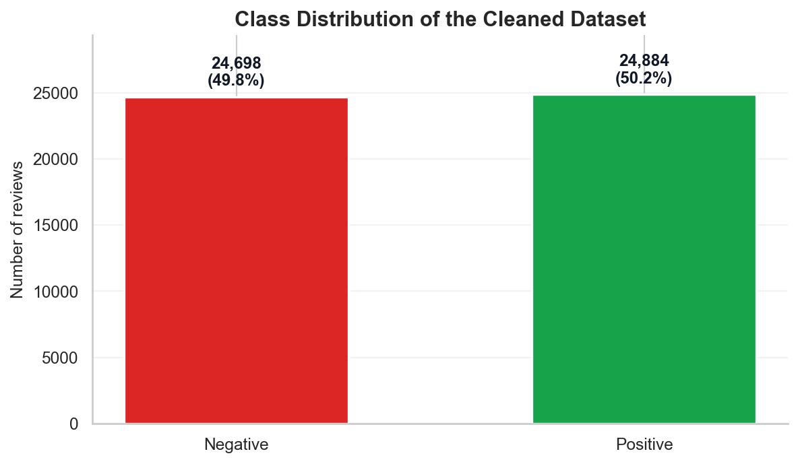
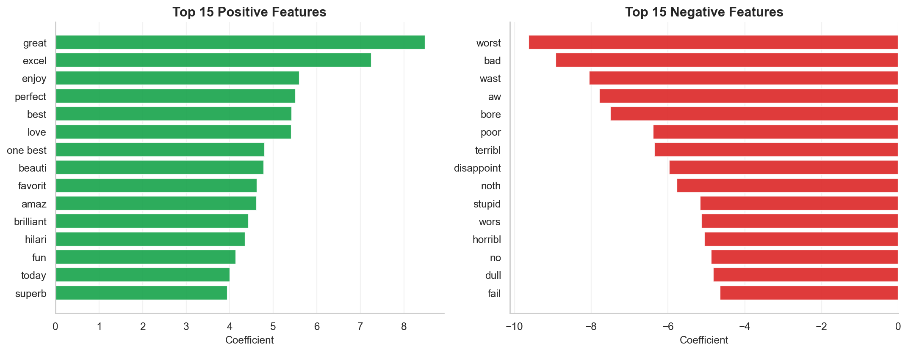
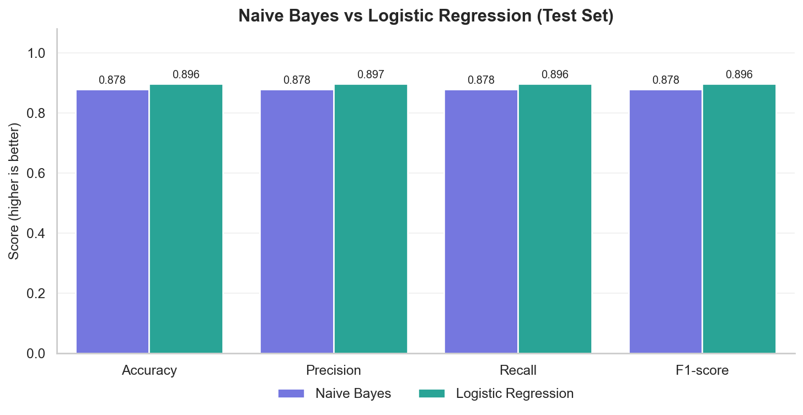
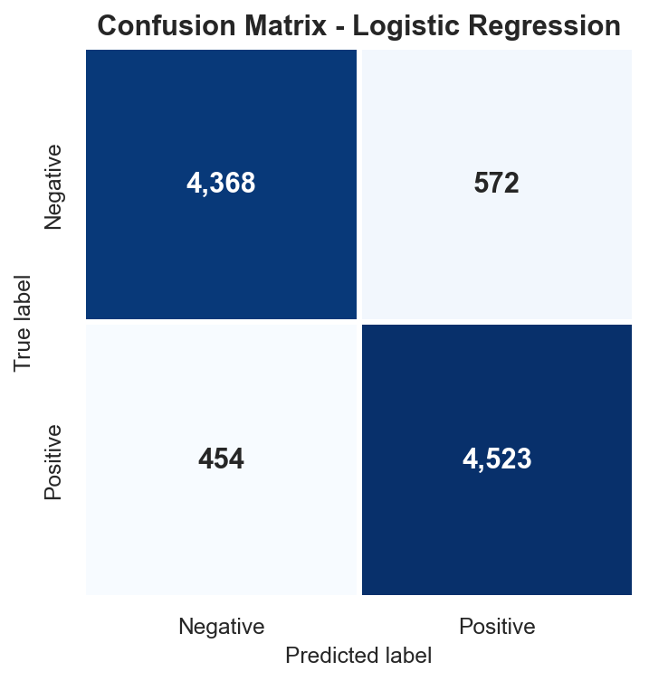

# Evaluation Report — Sentiment Analysis System

**Project:** Binary sentiment classification of IMDb movie reviews  
**Models:** Multinomial Naive Bayes and Logistic Regression  
**Selected model:** Logistic Regression  
**Evaluation date:** 20 November 2026  
**Data:** IMDb Large Movie Review Dataset (Maas et al., ACL 2011)

All numbers in this report were produced by `src/train.py` and stored in
`models/model_metadata.json`. Nothing is hard-coded or estimated.

---

## 1. Executive summary

Two classical machine-learning models were trained on 39,665 cleaned IMDb
reviews and evaluated on a stratified, held-out test set of 9,917 reviews. Both
models used the same preprocessing pipeline and the same TF-IDF matrix, which was
fitted on the training split only.

| Model | Accuracy | Precision (weighted) | Recall (weighted) | F1 (weighted) | Errors |
|---|---:|---:|---:|---:|---:|
| Multinomial Naive Bayes | 0.8779 | 0.8780 | 0.8779 | 0.8779 | 1,211 |
| **Logistic Regression** | **0.8965** | **0.8968** | **0.8965** | **0.8965** | **1,026** |

Logistic Regression improved accuracy by **1.86 percentage points** over Naive
Bayes and reduced the number of test-set errors from 1,211 to 1,026. It was
selected automatically using weighted F1, with accuracy as a tie-breaker.

The result is consistent with the expected behaviour of these models on
bag-of-words features: Naive Bayes is a fast, strong baseline, while Logistic
Regression can learn a better-weighted linear boundary when many tokens overlap
between the two classes.

---

## 2. Dataset

### 2.1 Source

- **Name:** IMDb Large Movie Review Dataset (IMDb 50K)
- **Authors:** Andrew L. Maas, Raymond E. Daly, Peter T. Pham, Dan Huang,
  Andrew Y. Ng, Christopher Potts
- **Paper:** *Learning Word Vectors for Sentiment Analysis*, ACL 2011
- **URL:** <https://ai.stanford.edu/~amaas/data/sentiment/>
- **Task:** binary sentiment classification (positive / negative)

The dataset contains 25,000 labelled positive and 25,000 labelled negative movie
reviews. The archive also has unlabelled reviews, which this project does not use.

### 2.2 Cleaning summary

| Check | Count |
|---|---:|
| Rows loaded | 50,000 |
| Missing reviews | 0 |
| Missing labels | 0 |
| Invalid labels | 0 |
| Empty reviews | 0 |
| Exact duplicate reviews removed | 418 |
| **Final rows** | **49,582** |
| Positive reviews | 24,884 (50.19%) |
| Negative reviews | 24,698 (49.81%) |
| Average review length | 231.35 words |
| Median review length | 173 words |

The classes are almost perfectly balanced, so accuracy is a meaningful headline
metric. Precision, recall and F1 are still reported because the two error types
have different costs in real applications.



### 2.3 Example reviews

Real examples are stored in `reports/dataset_sample.txt`. They include long,
informal reviews with HTML entities and punctuation, which motivates the cleaning
pipeline.

---

## 3. Train/test split

| Property | Value |
|---|---|
| Split | 80% train / 20% test |
| Stratified | Yes |
| Random state | 42 |
| Training rows | 39,665 |
| Test rows | 9,917 |
| Training negative / positive | 19,758 / 19,907 |
| Test negative / positive | 4,940 / 4,977 |

Stratification preserves the class ratio in both splits. The fixed random state
means the same rows are selected on every run with the same dataset and library
versions, which makes the experiment reproducible.

---

## 4. Preprocessing

The same `preprocess_text()` function is imported by training and prediction.
This prevents a common bug where the notebook and the deployed app clean text
differently.

Pipeline:

1. Normalise typographic apostrophes (`’` → `'`).
2. Lowercase the text.
3. Expand common contractions (`wasn't` → `was not`, `can't` → `can not`).
4. Unescape HTML entities and remove HTML tags.
5. Remove URLs and e-mail addresses.
6. Replace every non-letter character with a space.
7. Collapse repeated whitespace.
8. Tokenise with NLTK `word_tokenize(..., preserve_line=True)`.
9. Remove NLTK English stop-words, **keeping** negations and selected
   contrast/intensifier words.
10. Apply the NLTK Porter stemmer.
11. Join the surviving tokens with single spaces.

Examples of preserved words: `not`, `no`, `nor`, `never`, `none`, `nothing`,
`neither`, `nowhere`, `cannot`, `without`, `but`, `however`, `yet`, `very`,
`too`, `really`, `extremely`.

### Why preserve negations?

`good` and `not good` have opposite meanings. Removing `not` as a stop-word would
make the two phrases nearly identical to the vectorizer. The project therefore
subtracts a small sentiment keep-list from NLTK's stop-word list.

### Preprocessing examples

Before/after examples are saved in `reports/preprocessing_examples.txt`. For
example, a review containing “wasn't” is expanded to “was not” before
tokenisation, and “beautiful” becomes the stem `beauti`.

### Timing

| Stage | Time |
|---|---:|
| Preprocess 39,665 training reviews | 33.26 s |
| Preprocess 9,917 test reviews | 8.23 s |
| TF-IDF fit + transform | 13.59 s |
| Train Naive Bayes | 0.02 s |
| Train Logistic Regression | 0.72 s |

The preprocessing dominates runtime because tokenisation and stemming are
CPU-bound; the classifiers themselves are extremely fast on sparse TF-IDF
features.

---

## 5. Feature extraction

`TfidfVectorizer` settings:

| Setting | Value |
|---|---|
| N-grams | (1, 2) — unigrams and bigrams |
| Maximum features | 50,000 |
| Features learned | 50,000 |
| `min_df` | 2 |
| `max_df` | 0.95 |
| `sublinear_tf` | True |
| `strip_accents` | unicode |
| `lowercase` | False (text already lowercased) |
| Fitted on | **training split only** |

TF-IDF gives each term a weight proportional to its frequency in a review and
inversely proportional to the number of reviews containing it. The bigrams let
the model represent short phrases such as `not good`, `one best`, `wast time`
and `high recommend`.

The vectorizer is fitted with `fit_transform(X_train_clean)` and only
`transform(X_test_clean)` is called for the test data. The test vocabulary and
IDF weights therefore cannot leak into training.



### Strongest learned features

Logistic Regression coefficients, after stemming:

- **Positive:** `great` (8.4896), `excel` (7.2570), `enjoy` (5.6043),
  `perfect` (5.5129), `best` (5.4266), `love` (5.4145), `one best` (4.8047),
  `beauti` (4.7826), `favorit` (4.6263), `amaz` (4.6218).
- **Negative:** `worst` (-9.6320), `bad` (-8.9320), `wast` (-8.0556),
  `aw` (-7.7932), `bore` (-7.5020), `poor` (-6.3951), `terribl` (-6.3510),
  `disappoint` (-5.9744), `noth` (-5.7684), `stupid` (-5.1678).

These are global model signals, not per-review explanations. A token with a
large coefficient pushes the decision boundary towards one class on average.

---

## 6. Models and hyperparameters

### 6.1 Multinomial Naive Bayes

```python
MultinomialNB(alpha=1.0)
```

Naive Bayes applies Bayes' theorem with a conditional-independence assumption
between features. It is well suited to sparse word counts and is extremely fast.
`alpha=1.0` is Laplace smoothing, which prevents zero probabilities for unseen
words.

### 6.2 Logistic Regression

```python
LogisticRegression(
    C=1.0,
    solver="liblinear",
    max_iter=1000,
    random_state=42,
)
```

Logistic Regression learns one weight per TF-IDF feature and passes a linear
combination through a sigmoid. `liblinear` is a reliable solver for sparse,
medium-sized binary problems. `C=1.0` applies moderate regularisation.

### 6.3 Selection rule

The selected model is the one with the highest **weighted F1-score** on the test
set; accuracy breaks ties. Weighted F1 accounts for class support and balances
precision and recall, which is more informative than accuracy alone.

---

## 7. Metric definitions

Let TP, TN, FP and FN be the confusion-matrix counts.

- **Accuracy** = (TP + TN) / (TP + TN + FP + FN)
- **Precision (positive)** = TP / (TP + FP)
- **Recall (positive)** = TP / (TP + FN)
- **F1** = 2 × (precision × recall) / (precision + recall)
- **Weighted precision/recall/F1** = average of the per-class scores weighted by
  each class's support.
- **Macro F1** = unweighted average of the per-class F1 scores.

Because the test classes are nearly balanced (4,940 vs 4,977), macro and weighted
averages are almost identical.

---

## 8. Results

### 8.1 Headline comparison

| Metric | Naive Bayes | Logistic Regression | Difference |
|---|---:|---:|---:|
| Accuracy | 0.8779 | **0.8965** | +0.0186 |
| Precision (weighted) | 0.8780 | **0.8968** | +0.0188 |
| Recall (weighted) | 0.8779 | **0.8965** | +0.0186 |
| F1 (weighted) | 0.8779 | **0.8965** | +0.0186 |
| F1 (macro) | 0.8779 | **0.8965** | +0.0186 |
| Test errors | 1,211 | **1,026** | −185 |



### 8.2 Confusion matrices

**Logistic Regression (selected)**

|  | Predicted Negative | Predicted Positive |
|---|---:|---:|
| **True Negative** | 4,368 | 572 |
| **True Positive** | 454 | 4,523 |

- True-negative rate: 4,368 / 4,940 = **88.42%**
- False-positive rate: 572 / 4,940 = **11.58%**
- True-positive rate (recall): 4,523 / 4,977 = **90.88%**
- False-negative rate: 454 / 4,977 = **9.12%**
- Total errors: 1,026

**Multinomial Naive Bayes**

|  | Predicted Negative | Predicted Positive |
|---|---:|---:|
| **True Negative** | 4,299 | 641 |
| **True Positive** | 570 | 4,407 |

- True-negative rate: 4,299 / 4,940 = **87.02%**
- False-positive rate: 641 / 4,940 = **12.98%**
- True-positive rate: 4,407 / 4,977 = **88.55%**
- False-negative rate: 570 / 4,977 = **11.45%**
- Total errors: 1,211




### 8.3 Per-class reports

**Logistic Regression**

| Class | Precision | Recall | F1 | Support |
|---|---:|---:|---:|---:|
| Negative | 0.9058 | 0.8842 | 0.8949 | 4,940 |
| Positive | 0.8877 | 0.9088 | 0.8981 | 4,977 |
| Macro average | 0.8968 | 0.8965 | 0.8965 | 9,917 |
| Weighted average | 0.8968 | 0.8965 | 0.8965 | 9,917 |

**Multinomial Naive Bayes**

| Class | Precision | Recall | F1 | Support |
|---|---:|---:|---:|---:|
| Negative | 0.8829 | 0.8702 | 0.8765 | 4,940 |
| Positive | 0.8730 | 0.8855 | 0.8792 | 4,977 |
| Macro average | 0.8780 | 0.8779 | 0.8779 | 9,917 |
| Weighted average | 0.8780 | 0.8779 | 0.8779 | 9,917 |

The full text reports are in
`reports/classification_report_logistic_regression.txt` and
`reports/classification_report_naive_bayes.txt`.

---

## 9. Interpretation

### 9.1 Which model is better?

Logistic Regression wins on every headline metric. It makes 185 fewer errors
than Naive Bayes. The improvement is largest for positive-class recall
(0.9088 vs 0.8855): the linear model finds more genuinely positive reviews.

Naive Bayes is still a useful baseline. It trains in 0.02 seconds and reaches
87.79% accuracy, which is far above the 50% majority-class baseline. Its
independence assumption is clearly wrong for natural language, but the model
remains competitive because word presence is a strong sentiment signal.

### 9.2 Error balance

Neither model is strongly biased towards one class:

- Logistic Regression predicts negative slightly more precisely (0.9058) than
  positive (0.8877), but has higher recall for positive (0.9088) than negative
  (0.8842).
- Naive Bayes shows the same pattern in a milder form.

The false-positive and false-negative counts are therefore reasonably balanced,
which is desirable for a general-purpose demo.

### 9.3 Why accuracy is not the whole story

A trivial classifier that always predicts positive would score about 50.2% on
this test set. Both models are far above that. However, a real application may
care more about false negatives (missing a complaint) or false positives
(flagging a neutral review as angry), so the full confusion matrix is reported.

### 9.4 Confidence is not calibrated

The app displays `predict_proba` output as a confidence score. This is the
model's internal probability, not a guarantee. Logistic Regression on sparse
TF-IDF features is often overconfident on short or unusual text. The interface
therefore flags predictions below 60% as low-confidence, but a high score can
still be wrong. Probability calibration (for example, Platt scaling or isotonic
regression on a validation set) would be a sensible future improvement.

---

## 10. Qualitative error analysis

The following spot checks were run through the saved model with
`python src/predict.py "..." --show-cleaned`. They are illustrative examples,
not part of the test-set metrics.

| Input | Prediction | Confidence | Observation |
|---|---|---:|---|
| “Not bad at all.” | Negative | 97.98% | Cleaned text is `not bad`; the strong negative weight of `bad` dominates. A human reads this as mildly positive. |
| “I did not enjoy this movie.” | Positive | 82.76% | Cleaned text is `not enjoy movi`; the model has learned `enjoy` as positive but does not explicitly model negation scope. |
| “I liked parts of it and disliked other parts.” | Positive | 57.55% | Correctly low confidence for a genuinely mixed review. |
| “The cinematography was beautiful and the cast tried hard, but the script was a mess and the ending fell flat.” | Negative | 92.60% | The negative clause dominates, which is plausible but not guaranteed. |
| “Oh great, another sequel that nobody asked for. Truly a masterpiece... if you enjoy wasting money.” | Negative | 69.95% | Sarcasm is detected only indirectly through words such as `wast`; confidence is moderate. |

These examples show both the strength and the limits of a bag-of-words model:
it captures lexical sentiment well, but it does not understand syntax, scope or
pragmatics.

---

## 11. Limitations and threats to validity

1. **Binary label space.** The dataset has no neutral examples. The model cannot
   produce a reliable neutral class, and the app does not pretend otherwise.
2. **Test set used for model selection.** The reported test score for the
   selected model is slightly optimistic because the same test set was used to
   choose between two candidates. No hyperparameter search was performed, which
   limits the effect, but a separate validation split would be stricter.
3. **Domain mismatch.** IMDb reviews are long movie reviews. Short product
   comments, tweets or chat messages have different vocabulary and length
   distributions.
4. **Bag-of-words limits.** Word order is represented only through bigrams.
   Sarcasm, irony, negation scope and long-range dependencies are not modelled.
5. **No probability calibration.** Confidence scores are raw model probabilities.
6. **Duplicate removal.** 418 exact duplicates were removed. Near-duplicates may
   remain and could inflate test performance slightly.
7. **Single split.** One stratified 80/20 split was used. Cross-validation would
   give a more stable estimate of variance.
8. **Library versions.** Results can shift slightly across scikit-learn, NLTK and
   pandas versions. The tested versions are recorded in the metadata.

---

## 12. Reproducibility

To reproduce this report:

```bash
python scripts/download_dataset.py
python src/train.py
```

The training script writes:

- `models/sentiment_model.pkl`
- `models/tfidf_vectorizer.pkl`
- `models/model_metadata.json`
- all charts and classification reports in `reports/`

The random state, split fraction and TF-IDF settings are fixed. Re-running on the
same data and library versions should reproduce the numbers in this report (up to
tiny platform-level variation).

Recorded runtime versions:

| Package | Version |
|---|---|
| Python | 3.14.4 |
| scikit-learn | 1.8.0 |
| NLTK | 3.10.4 |
| pandas | 3.0.2 |
| NumPy | 2.4.4 |
| Joblib | 1.5.3 |
| Streamlit | 1.60.0 |
| Starlette | 0.49.3 |

---

## 13. Conclusion

The project successfully builds a leakage-free classical NLP pipeline and
compares two standard classifiers on a real, large sentiment dataset.
Logistic Regression is the better model on this split, reaching **89.65% test
accuracy** and a **0.8965 weighted F1**, compared with **87.79%** and **0.8779**
for Naive Bayes. The selected model, vectorizer and metadata are saved and loaded
by a Streamlit application that performs the same preprocessing as training.

The evaluation also makes the limitations visible: the model is binary, its
confidence is not calibrated, and it can misread negation and sarcasm. Reporting
those weaknesses is part of a trustworthy machine-learning project.
